# Azure Network Protocol Analysis

## Project Summary

This project demonstrates the deployment of Windows 11 and Ubuntu virtual machines in Microsoft Azure and the analysis of network traffic using Wireshark. Both virtual machines were placed on the same Azure virtual network and subnet.

I generated, filtered, and examined ICMP, SSH, DHCP, DNS, and RDP traffic. I also modified a Network Security Group rule to block ICMP communication and then restored connectivity.

## Technologies and Environments

- Microsoft Azure
- Windows 11 Pro
- Ubuntu Server 24.04 LTS
- Azure Virtual Machines
- Azure Virtual Network and Subnet
- Azure Network Security Groups
- Wireshark
- Windows PowerShell
- Remote Desktop Protocol
- Secure Shell

## Network Configuration

- Windows VM private IP: `172.16.0.4`
- Ubuntu VM private IP: `172.16.0.5`
- Shared subnet: `172.16.0.0/24`

> Public IP addresses, account information, and Azure subscription details were removed from the documentation.

## Project Walkthrough

### 1. Azure Resource Group

I created a dedicated Azure resource group containing the Windows and Ubuntu virtual machines and their supporting networking resources.

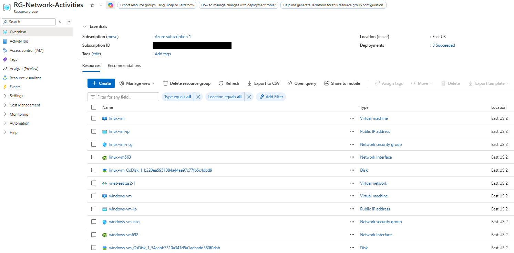

### 2. Windows VM Configuration

I deployed a Windows 11 Pro virtual machine with two virtual CPUs and 8 GiB of RAM. The VM received the private IP address `172.16.0.4` and was connected to the shared Azure virtual network and subnet.

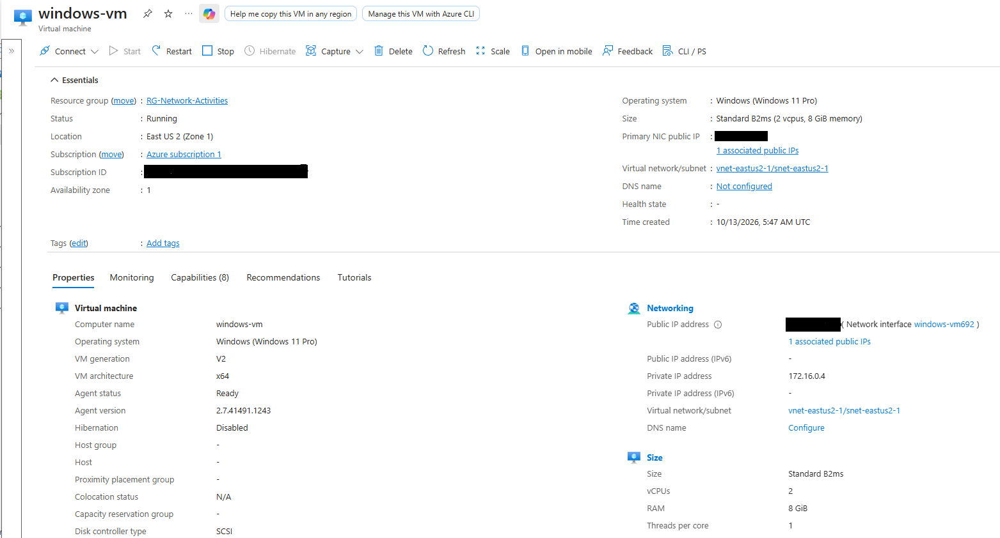

### 3. Ubuntu VM Configuration

I deployed an Ubuntu Server 24.04 LTS virtual machine with two virtual CPUs and 8 GiB of RAM. The VM received the private IP address `172.16.0.5` and was connected to the same virtual network and subnet as the Windows VM.

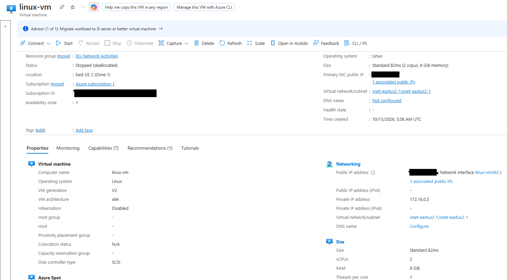

### 4. Testing Private ICMP Connectivity

From the Windows VM, I used PowerShell to ping the Ubuntu VM:

`ping 172.16.0.5`

Wireshark captured ICMP echo requests from `172.16.0.4` and echo replies from `172.16.0.5`, confirming successful communication across the shared virtual network.

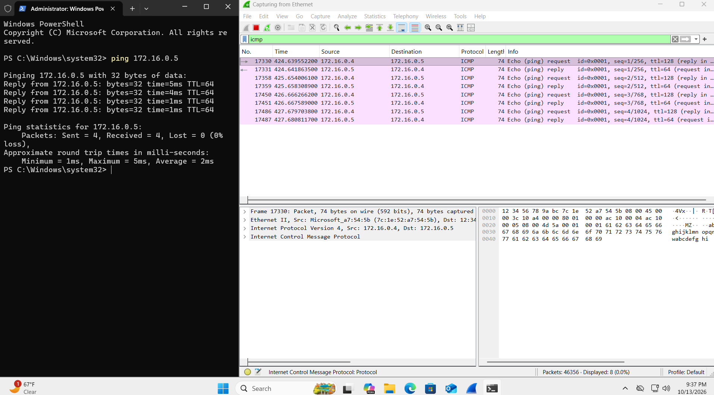

### 5. Testing External Connectivity

I used PowerShell to ping a public domain while filtering for ICMP traffic in Wireshark. The domain resolved to a public IP address, and the VM successfully received echo replies.

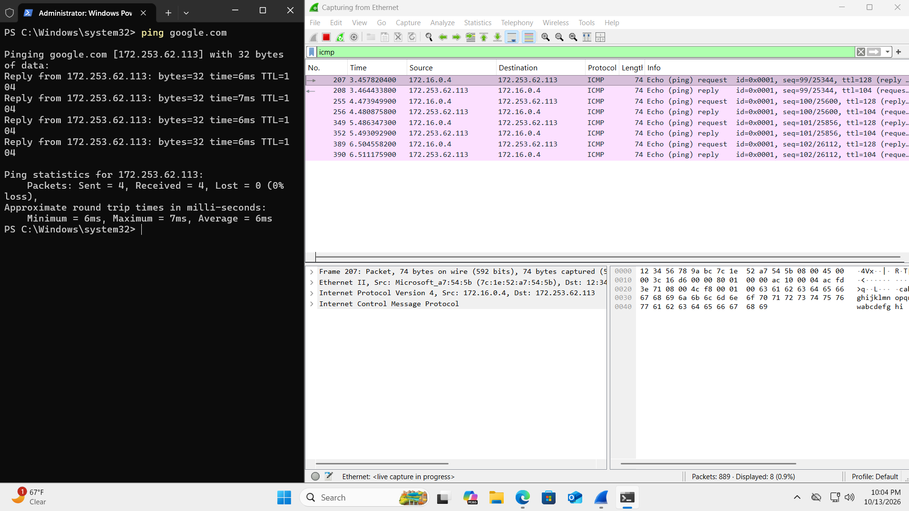

### 6. Blocking ICMP with a Network Security Group

I started a continuous ping from the Windows VM to the Ubuntu VM and then created an inbound Network Security Group rule that denied ICMP traffic to the Ubuntu VM.

PowerShell displayed timed-out requests, while Wireshark captured outbound echo requests without corresponding replies. This demonstrated how an NSG can control communication between Azure resources.

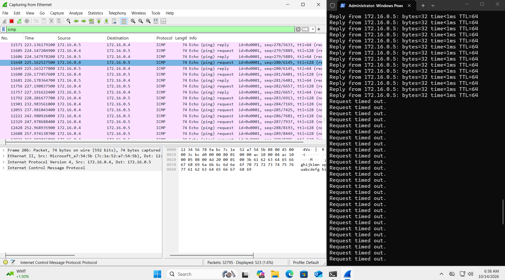

### 7. Restoring ICMP Connectivity

I removed the deny rule from the Ubuntu VM's Network Security Group. The continuous ping began receiving replies again, confirming that connectivity had been restored.

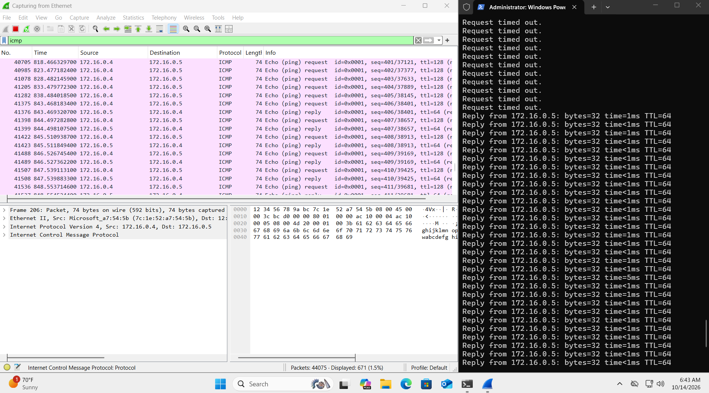

### 8. Analyzing SSH Traffic

From the Windows VM, I established an SSH connection to the Ubuntu VM over TCP port 22:

`ssh labuser@172.16.0.5`

I ran Linux commands to verify remote access while Wireshark captured the encrypted SSH traffic.

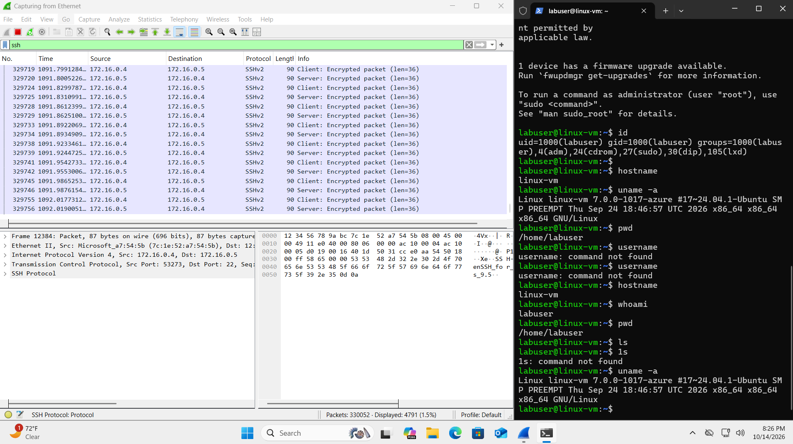

### 9. Analyzing DHCP Traffic

I used `ipconfig /renew` to renew the Windows VM's network configuration and examined the associated DHCP traffic in Wireshark.

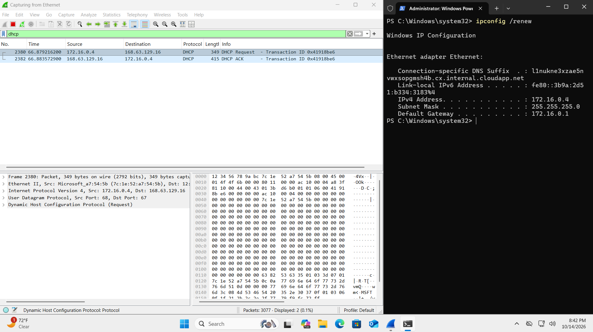

### 10. Analyzing DNS Traffic

I used `nslookup` to resolve public domain names into IP addresses while Wireshark captured the corresponding DNS queries and responses.

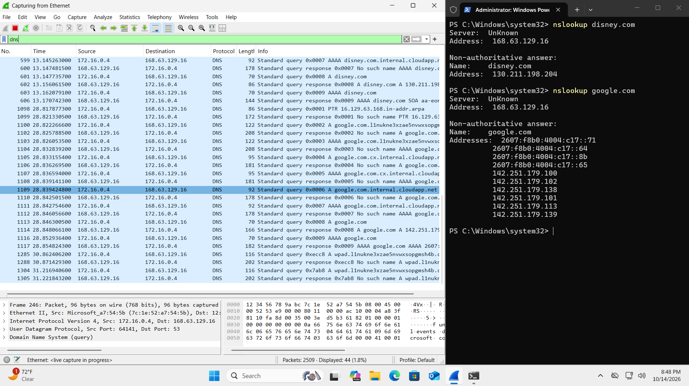

### 11. Analyzing RDP Traffic

Because the Windows VM was being controlled through Remote Desktop, I filtered Wireshark for TCP port 3389 and observed the continuous flow of RDP traffic supporting the active session.

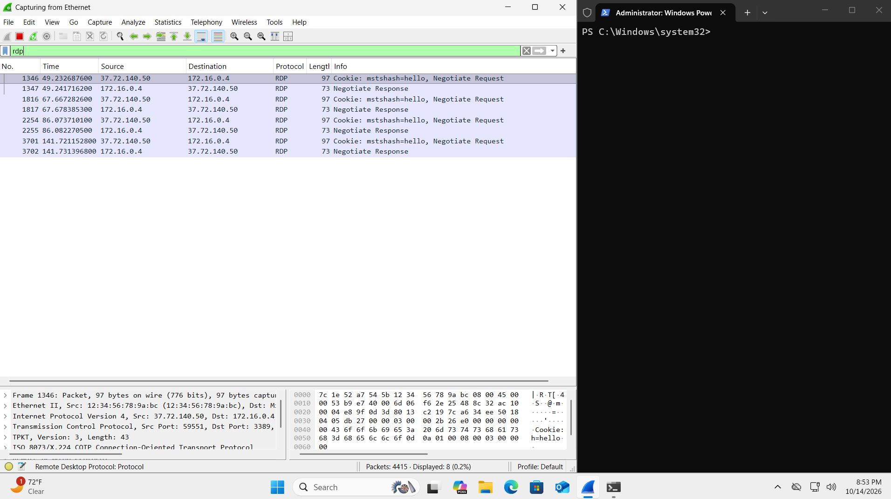

## Skills Demonstrated

- Provisioning Windows and Linux virtual machines in Azure
- Configuring virtual networks and subnets
- Using private IP addressing
- Connecting to a Windows VM through RDP
- Connecting to Linux through SSH
- Capturing and filtering network packets with Wireshark
- Troubleshooting connectivity with `ping`, `ipconfig`, and `nslookup`
- Configuring Network Security Group rules
- Analyzing ICMP, SSH, DHCP, DNS, and RDP traffic
- Documenting technical procedures and results

## Key Takeaways

This project demonstrated how several common network protocols appear during real communication between cloud-hosted systems. It also showed how Azure Network Security Groups affect traffic flow and how packet captures can help identify whether requests and responses are successfully reaching their destinations.
